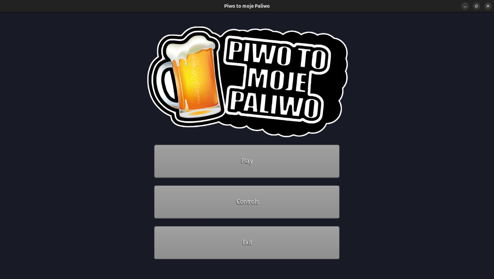
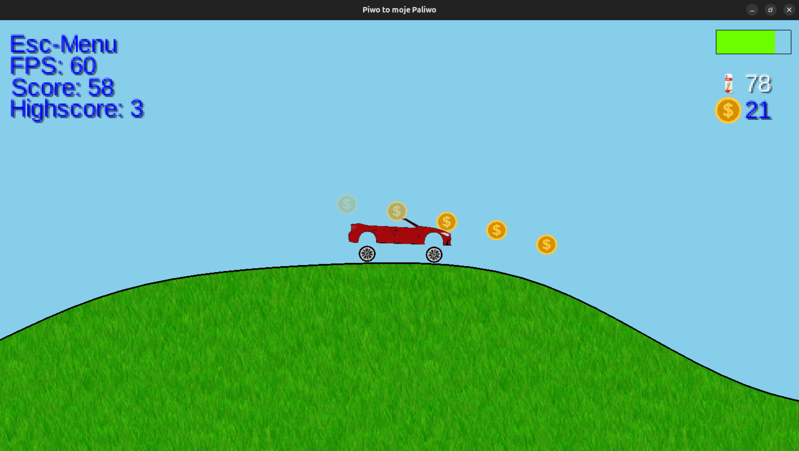
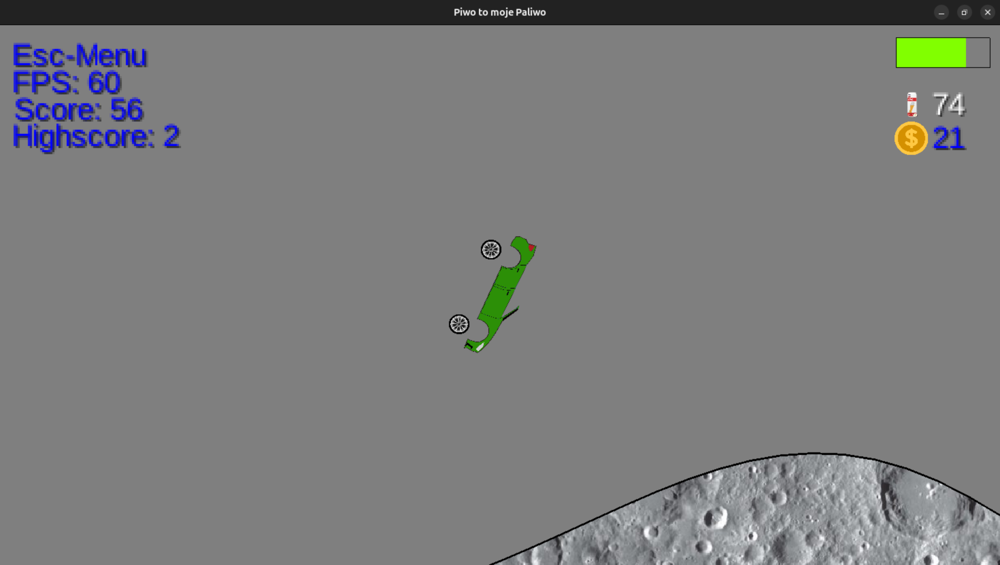

# Platform Game "Beer is my Fuel"
*(original title: "Piwo to moje Paliwo")*

## Authors
Maciej Dobrowolski, Marcin Sikorski, Marcin Bagnowski, Joachim Czarnecki

## Basic Information
Project created for the subject Application Programming 2023

### Technology
The project was implemented in Java, using the LibGDX framework.  
It was built and managed with Gradle, which handled dependencies, project structure, and build automation.

### Project Theme:
A single-player platform game inspired by Hill Climb Racing.

### Features:
- Procedurally generated map divided into chunks
- Vehicle-to-map collision physics and gravity, simple suspension system
- Ability to move the vehicle forward and backward
- Ability to rotate the vehicle around its own axis while in the air
- Fuel level mechanic and collecting fuel while driving
- Collecting coins
- Saving best scores on the map
- Multiple maps
- Different vehicle colors

## How to run

1. Make sure you have Java 17 (or compatible version) installed.
2. Install Gradle (or use the Gradle Wrapper included in the project).
3. Clone or download the project source code.
4. Navigate to the project’s root directory.
5. Run the following command to build and run the game:
```bash
# Linux / Mac
./gradlew run 
```
```bash
# Windows
gradlew.bat run
```
6. The game should launch in a new window.

## Preview




